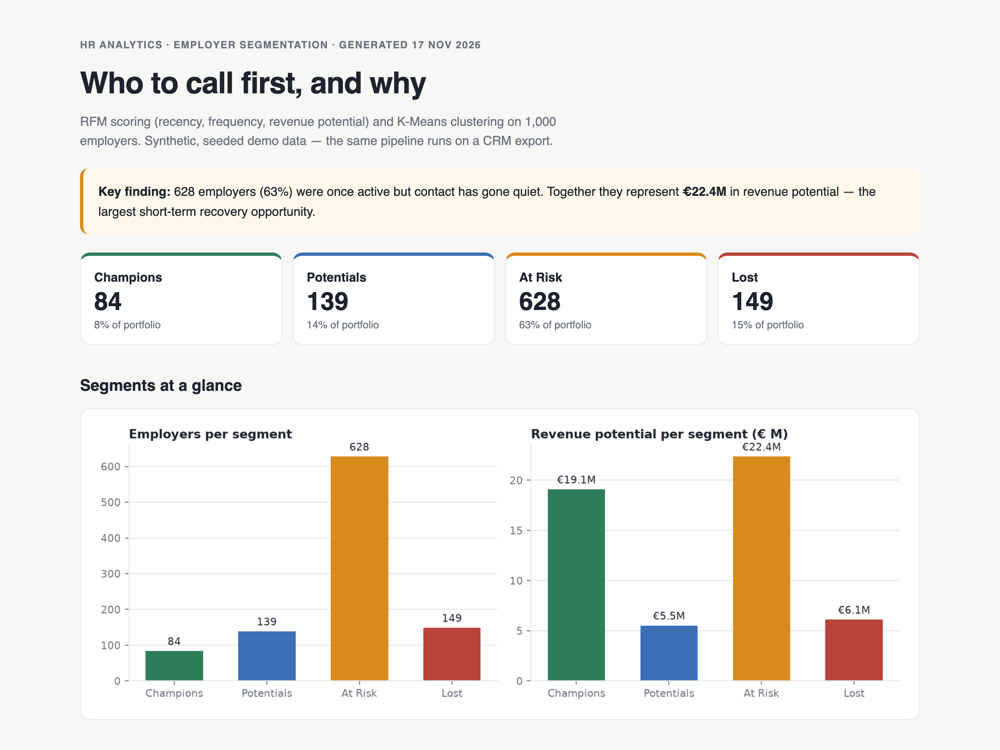
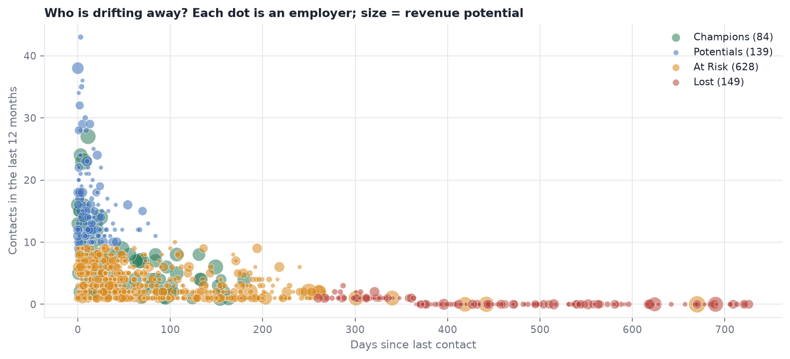

# HR Analytics — Employer Segmentation

[](https://github.com/phlppgdfry/hr-analytics-segmentation/actions/workflows/ci.yml)


End-to-end pipeline that segments an employer portfolio using **RFM scoring + K-Means clustering**, plus a business-rule guardrail, and turns the result into a call list for account managers.

**[▶ Open the generated report](https://phlppgdfry.github.io/hr-analytics-segmentation/)** — rebuilt by CI from the pipeline on every push.

<a href="https://phlppgdfry.github.io/hr-analytics-segmentation/"></a>

---

## Business case

Many HR service providers treat their entire employer portfolio the same way — same contact frequency, same approach, same priority. This pipeline changes that.

By scoring every employer on **Recency** (how long since last contact), **Frequency** (how often they interact) and **Monetary** (estimated revenue potential), the pipeline automatically classifies the full portfolio into four actionable segments. The output is designed for a daily-refreshed Power BI dashboard (DAX measures and semantic model in [`powerbi/`](powerbi/)); the [HTML report](https://phlppgdfry.github.io/hr-analytics-segmentation/) is the open stand-in anyone can view without a licence.

**Results on a synthetic, seeded portfolio of 1,000 employers** (reproduce with the commands below):

| Segment | Count | Share | Avg revenue potential | Avg priority score | Recommended action |
|---|---|---|---|---|---|
| 🟢 Champions | 84 | 8% | €227,000 | 45 / 100 | Retain — proactive contact |
| 🔵 Potentials | 139 | 14% | €40,000 | 40 / 100 | Develop — identify upsell |
| 🟡 At Risk | 628 | **63%** | €36,000 | 58 / 100 | Reactivate — personal re-contact |
| 🔴 Lost | 149 | 15% | €41,000 | 92 / 100 | Evaluate — win-back or write off |

> **Key finding:** 63% of employers have drifted into the At Risk segment — they were once active but contact has gone quiet. Together they hold €22.4M in revenue potential, the highest short-term recovery opportunity.

### A model is not a decision: the Champion guardrail

Plotting the clusters showed something the summary table hid: K-Means on RFM is pulled by revenue
size, so 10 large employers that **nobody had contacted for 180–670 days** were labelled
*Champions* (€2.8M). Telling an account manager "retain, all is well" about a two-year-silent
client is the wrong advice.

The pipeline now applies an explicit business rule after clustering: a Champion without contact
for more than 180 days becomes **At Risk**. It is configurable
(`EmployerSegmentation(champion_max_recency_days=...)`, `None` switches it off), tested, and every
moved row keeps its original cluster plus a `rule_override` reason, so the decision stays auditable.



---

## Architecture

```
data/raw/
├── employers.csv          # CRM export: employer master data
└── interactions.csv       # Contact history

src/
├── ingestion/
│   ├── loader.py          # CSV loading + ingestion report
│   ├── gdpr_anonymizer.py # PII pseudonymisation before processing
│   └── schema_definitions.py # Pandera schema validation
├── transformation/
│   └── segmentation.py    # RFM computation + K-Means clustering
├── validation/
│   └── data_quality.py    # Schema checks, null thresholds, outlier flags
├── analysis/
│   └── segment_profiles.py # Aggregated segment statistics
├── report.py              # HTML report: charts, profiles, call list
└── main.py                # Pipeline orchestrator

powerbi/
├── measures/kpi_measures.dax  # DAX measures (KPIs, churn, time intelligence)
└── semantic_model.md          # Table schema and relationships

docs/
├── analytics_roadmap.md   # Prioritised initiative roadmap (Q3 2026 → H1 2027)
└── gdpr_register.md       # Processing register and retention policy

tests/
├── test_segmentation.py
├── test_data_quality.py
├── test_gdpr_anonymizer.py
├── test_segment_profiles.py
└── test_loader.py
```

---

## Pipeline steps

```
[1] Load      → employers + interactions from data/raw/
[2] Validate  → schema, nulls, referential integrity
[3] Segment   → RFM scores → MinMax normalisation → K-Means (n=4) → business rules
[4] Profile   → aggregated stats per segment → data/processed/
[5] Report    → charts, profiles and call list → docs/report/index.html (python -m src.report)
```

---

## Getting started

**Requirements:** Python 3.11+

```bash
pip install -r requirements.txt

# Generate synthetic demo data (1,000 employers, ~7,700 interactions)
python -m src.generate_demo_data

# Run the full pipeline
python -m src.main

# Build the HTML report with charts and the call list → docs/report/index.html
python -m src.report

# Options
python -m src.main --env staging --n-segments 4
python -m src.main --skip-validation
```

**Run tests:**

```bash
pytest                                        # 72 tests
pytest --cov=src --cov-report=term-missing    # 98% coverage
ruff check src/ tests/                        # linting
mypy src/ --ignore-missing-imports            # type checking
```

---

## DAX examples (Power BI)

**Churn Risk Score (0–100):**
```dax
[Churn Risk Score] =
VAR DaysSinceContact =
    DATEDIFF(CALCULATE(MAX(Interactions[InteractionDate])), TODAY(), DAY)
VAR FrequencyLast12M =
    CALCULATE(
        COUNTROWS(Interactions),
        DATESINPERIOD(Interactions[InteractionDate], TODAY(), -12, MONTH)
    )
VAR NormRecency    = MIN(DIVIDE(DaysSinceContact, 365), 1)
VAR NormFrequency  = 1 - MIN(DIVIDE(FrequencyLast12M, 24), 1)
RETURN
    ROUND((NormRecency * 0.6 + NormFrequency * 0.4) * 100, 0)
```

**Segment label with traffic-light indicator:**
```dax
[Segment Prioriteit Label] =
SWITCH(
    TRUE(),
    [Churn Risk Score] < 20 && [Totaal Omzetpotentieel] > 50000, "🟢 Champion",
    [Churn Risk Score] < 40,                                      "🔵 Potential",
    [Churn Risk Score] < 70,                                      "🟡 At Risk",
                                                                  "🔴 Lost"
)
```

---

## GDPR

- All PII fields are pseudonymised via `gdpr_anonymizer.py` before processing.
- No personal data is written to `data/processed/`.
- Processing register and retention schedule: [`docs/gdpr_register.md`](docs/gdpr_register.md).
- Legal basis: legitimate interest (B2B employer relationship management).

---

## Roadmap

| Status | Initiatives |
|---|---|
| ✅ Done | Segmentation pipeline, business-rule guardrail, data quality validation, GDPR pseudonymisation, DAX measures, HTML report + call list |
| Next | Predictive churn model, CRM integration, Power BI report file on the semantic model |
| Later | Natural-language querying, market benchmarking, anomaly detection |

Full details: [`docs/analytics_roadmap.md`](docs/analytics_roadmap.md)

---

## Dependencies

| Package | Purpose |
|---|---|
| pandas | Data manipulation |
| scikit-learn | K-Means, MinMaxScaler |
| pandera | Schema validation |
| matplotlib | Report charts |
| pytest / coverage | Testing (72 tests, 98% coverage) |
| ruff / mypy | Linting and type checking |

---

## License

MIT
